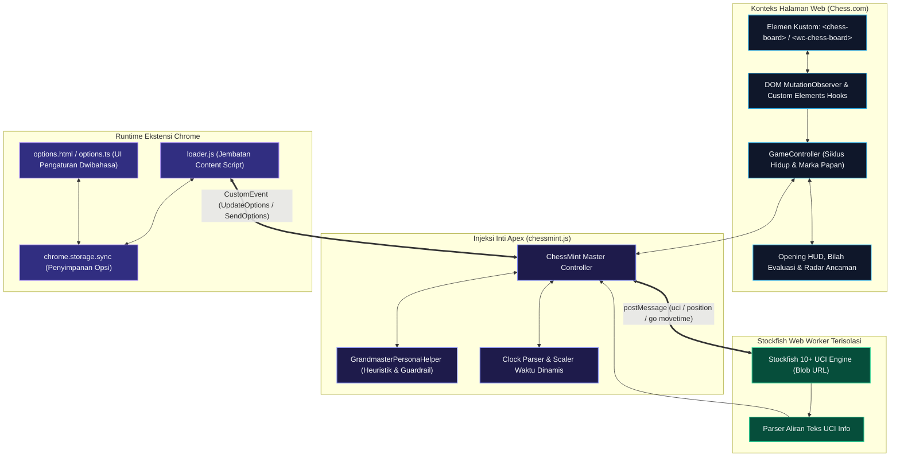

<div align="center">

<p align="center">
  
</p>

# APEX CHESS

### Asisten Mesin Taktis & Penganalisis Real-Time untuk Chess.com

[](https://github.com/Rangga11268/apex-chess/releases/tag/v2.2.0)
[](https://developer.chrome.com/docs/extensions/mv3/intro/)
[](https://stockfishchess.org/)
[](https://www.typescriptlang.org/)
[](LICENSE)
[](test/test_chessmint.js)

<p align="center">
  <a href="./README.md">English</a> • <b>Bahasa Indonesia</b>
</p>

<p align="center">
  <a href="#ikhtisar">Ikhtisar</a> •
  <a href="#fitur-unggulan">Fitur Unggulan</a> •
  <a href="#emulasi-gaya-grandmaster">Gaya Grandmaster</a> •
  <a href="#arsitektur-sistem">Arsitektur</a> •
  <a href="#panduan-instalasi">Instalasi</a> •
  <a href="#konfigurasi">Konfigurasi</a> •
  <a href="#kebijakan-fair-play">Fair Play</a>
</p>

<p align="center">
  
</p>

</div>

---

## Ikhtisar

**Apex Chess** adalah ekstensi peramban berbasis Chromium modern yang menghadirkan kalkulasi mesin catur Stockfish lokal, rekomendasi spektrum langkah taktis, emulasi gaya bermain Grandmaster dunia, dan pengenalan pembukaan (*opening recognition*) secara langsung di [Chess.com](https://www.chess.com).

Dirancang dengan prinsip privasi dan efisiensi tinggi, Apex Chess menjalankan Stockfish sepenuhnya di dalam Web Worker lokal pada perangkat Anda. **Tidak ada data permainan, string FEN, maupun kredensial akun yang dikirim ke server luar.**

---

## Fitur Unggulan

| Kategori | Fitur | Deskripsi |
| :--- | :--- | :--- |
| **Inti Mesin** | **Worker Stockfish Lokal** | Menjalankan mesin Stockfish UCI secara *offline* melalui Blob URL Web Worker tanpa membebani jaringan luar. |
| **Taktik** | **Emulasi Grandmaster** | Tiru gaya bermain juara dunia (Carlsen, Tal, Kasparov, Nakamura, Karpov) dengan batas pengaman blunder $\le 65\text{ cp}$. |
| **Kecepatan** | **Skalasi Waktu Adaptif** | Membaca jam catur pertandingan secara dinamis: 1200ms (Rapid), 350-650ms (Blitz), 120ms (Bullet), hingga 60ms (Panik <10s). |
| **Visualisasi**| **Spektrum Kualitas Langkah**| Klasifikasi langkah dengan panah dan lencana warna: *Brilliant* (`#1baca6`), *Best Move* (`#9eba5a`), *Excellent*, *Inaccuracy*, dan *Blunder*. |
| **Buku Teori** | **HUD Pembukaan & ECO** | Mengenali nama resmi pembukaan catur (misal `[C60] Ruy Lopez`, `[B20] Sicilian Defense`) langsung di atas papan catur. |
| **Evaluasi** | **Bilah Keunggulan Dinamis** | Skor angka centipawn dan penghitung langkah skakmat (*forced mate*) yang otomatis menyesuaikan orientasi bidak (Putih/Hitam). |
| **Pertahanan** | **Radar Ancaman Lawan** | Menandai petak incaran serangan utama lawan dengan warna merah transparan (`#ef4444`) saat menunggu giliran lawan. |
| **Kerahasiaan** | **Tombol Boss Key (`H`)** | Sembunyikan atau tampilkan seketika seluruh panah, lencana, eval bar, dan HUD dalam 1 milidetik (*stealth mode*). |
| **Kalkulasi** | **Pencarian Mendalam (`Spasi`)**| Memicu dorongan kalkulasi instan ke Kedalaman 22 (*Depth 22*, durasi 4000ms) untuk posisi taktis yang rumit. |
| **Ketahanan** | **Notifikasi Self-Healing** | Sistem toast *dual-payload* dengan perbaikan DOM mandiri dan fallback banner HUD untuk kompatibilitas Chess.com Vue 3. |
| **Aksesibilitas**| **UI Bersih Anti-Slop** | Antarmuka bebas dari polusi emoji, memenuhi standar kontras tinggi WCAG 2.1 AA, dan toggle dwibahasa instan (ID/EN). |

---

## Emulasi Gaya Grandmaster

Alih-alih bermain seperti kalkulator mesin yang kaku dan mudah ditebak, Apex Chess menghadirkan personalisasi gaya bermain manusiawi yang terinspirasi dari filosofi para legenda catur dunia:

```
┌─────────────────┬──────────────────────────────────┬───────────────────────────────────────────┐
│ Persona         │ Filosofi Permainan               │ Karakteristik Taktis & Strategis          │
├─────────────────┼──────────────────────────────────┼───────────────────────────────────────────┤
│ Magnus Carlsen  │ Squeeze Endgame & Minim Risiko   │ Memprioritaskan transisi babak akhir,     │
│                 │                                  │ pertukaran menteri, dan kontrol posisi    │
│ Mikhail Tal     │ Serangan Romantis & Pengorbanan  │ Serangan agresif ke sayap raja, pembukaan │
│                 │                                  │ lajur tajam, dan pengorbanan perwira      │
│ Garry Kasparov  │ Dominasi Pusat & Serangan Dinamis│ Penguasaan mutlak petak pusat (d4/e4),    │
│                 │                                  │ inisiatif menyerang dan mobilitas perwira │
│ Hikaru Nakamura │ Taktik Kilat & Jebakan Tajam     │ Manuver kuda lincah, diagonal fianchetto, │
│                 │                                  │ jebakan taktis cepat dan serangan sayap   │
│ Anatoly Karpov  │ Cekikan Posisional (Profilaksis) │ Membatasi ruang gerak lawan, struktur     │
│                 │                                  │ pion kokoh, dan manuver tenang mencekik   │
│ Stockfish Murni │ Kalkulasi Matematis              │ Evaluasi objektif murni tanpa bias gaya   │
└─────────────────┴──────────────────────────────────┴───────────────────────────────────────────┘
```

> [!IMPORTANT]
> **Batas Pengaman Anti-Blunder ($\le 65\text{ cp}$)**: Rekomendasi langkah setiap persona Grandmaster dibatasi secara ketat dalam toleransi maksimal $65\text{ centipawn}$ dari langkah terbaik Stockfish. Jika langkah khas persona melampaui batas ini atau mengarah pada skakmat lawan, Apex Chess otomatis membatalkannya dan memilih langkah terbaik mesin.

---

## Manajemen Waktu Adaptif Blitz & Bullet

Apex Chess memantau jam catur pertandingan secara *real-time* untuk memastikan Anda tidak pernah kehabisan waktu (*anti-flag*):

```
Sisa Waktu pada Jam Catur
 ├── > 340s (Klasik / Rapid / Bot)    ──> Kalkulasi 1200ms | Kedalaman Penuh | Jeda 800-2200ms
 ├── 71s - 340s (Blitz 5 Menit)       ──> Kalkulasi  650ms | Kedalaman <= 11 | Jeda 400-850ms
 ├── 11s - 70s  (Blitz 3m / Bullet 1m) ─> Kalkulasi  120ms | Kedalaman <= 8  | Jeda 80-220ms
 └── <= 10s     (Mode Panik Darurat)  ──> Kalkulasi   60ms | Kedalaman <= 6  | Jeda 30-80ms (Langkah #1 Wajib)
```

---

## Arsitektur Sistem



---

## Panduan Instalasi

### Metode A: Unduh Rilis Siap Pakai (Disarankan)
1. Unduh arsip **[`apex-chess-v2.2.0.zip`](https://github.com/Rangga11268/apex-chess/releases/download/v2.2.0/apex-chess-v2.2.0.zip)** dari halaman rilis terbaru.
2. Ekstrak file zip ke folder di komputer Anda.
3. Buka peramban (Chrome, Brave, Edge, Opera, atau Vivaldi) dan masuk ke halaman ekstensi:
   - **Chrome**: `chrome://extensions/`
   - **Brave**: `brave://extensions/`
   - **Edge**: `edge://extensions/`
4. Aktifkan **Developer mode** (*Mode pengembang*) di pojok kanan atas.
5. Klik tombol **Load unpacked** (*Muat yang belum dibongkar*) dan pilih folder hasil ekstrak (atau folder `dist`).
6. Buka [Chess.com](https://www.chess.com) dan mulai bermain!

### Metode B: Bangun dari Source Code
```bash
# 1. Klon repositori
git clone https://github.com/Rangga11268/apex-chess.git
cd apex-chess

# 2. Pasang dependensi
npm install

# 3. Kompilasi bundle ekstensi
npm run build

# 4. Jalankan pengujian otomatis
npm test
```
Muat folder `dist/` melalui menu **Load unpacked** di peramban Anda.

---

## Konfigurasi

Klik ikon Apex Chess di bilah alat peramban Anda untuk menyesuaikan preferensi:

| Opsi Pengaturan | Standar | Pilihan / Rentang | Kegunaan |
| :--- | :---: | :---: | :--- |
| **Kedalaman Engine** | `12` | `1 – 25` | Batas kedalaman pencarian kalkulasi (*search depth*) |
| **Thread CPU** | `2` | `1 – 8` | Jumlah thread konkurensi Web Worker |
| **Gaya Grandmaster** | `Stockfish Murni`| `Engine`, `Magnus`, `Tal`, `Kasparov`, `Nakamura`, `Karpov` | Emulasi gaya bermain dunia dengan pengaman $\le 65\text{ cp}$ |
| **Gaya Analisis** | `Spektrum Lengkap`| `Spektrum Lengkap`, `Anti-Deteksi (Aman)`, `Langkah Terbaik` | Mode klasifikasi visual rekomendasi langkah |
| **Petunjuk Langkah** | `Aktif` | Sakelar | Menampilkan panah rekomendasi hanya di giliran Anda |
| **Analisis Kualitas**| `Aktif` | Sakelar | Menampilkan badge kualitas langkah di petak tujuan |
| **Bilah Evaluasi** | `Aktif` | Sakelar | Menampilkan bilah keuntungan centipawn di samping papan |
| **Bilah Progres** | `Aktif` | Sakelar | Indikator progres kalkulasi Stockfish secara real-time |
| **HUD Pembukaan** | `Aktif` | Sakelar | Menampilkan nama pembukaan resmi dan kode ECO |
| **Radar Ancaman** | `Aktif` | Sakelar | Menandai petak incaran serangan lawan dengan warna merah |
| **Waktu Adaptif** | `Aktif` | Sakelar | Menyesuaikan kecepatan kalkulasi dengan jam catur |
| **Boss Key (`H`)** | `Aktif` | Sakelar | Tombol pintas 1ms untuk menyembunyikan semua indikator |
| **Deep Search (`Spasi`)**| `Aktif` | Sakelar | Tekan spasi untuk kalkulasi instan Kedalaman 22 (4000ms) |
| **Langkah Otomatis** | `Nonaktif`| Sakelar | Menjalankan langkah otomatis dengan jeda manusiawi |
| **Bahasa** | `ID / EN` | `ID`, `EN` | Pengubah bahasa antarmuka secara instan |

---

## Tombol Pintas (*Hotkeys*)

| Tombol | Aksi | Fungsi |
| :---: | :--- | :--- |
| <kbd>H</kbd> | **Boss Key (Mode Senyap)** | Menyembunyikan atau menampilkan seketika seluruh panah, badge, bilah evaluasi, dan HUD. |
| <kbd>Spasi</kbd> | **Kalkulasi Mendalam** | Memicu kalkulasi mendalam darurat pada Kedalaman 22 dengan notifikasi banner status. |

---

## Struktur Proyek

```
apex-chess/
├── dist/                      # Bundle produksi ekstensi (Load Unpacked)
│   ├── css/                   # Stylesheet visual (depthbar, evalbar, options)
│   ├── html/                  # Antarmuka popup ekstensi (options.html)
│   ├── img/                   # Asset visual dan ikon brand
│   ├── js/                    # Bundle hasil kompilasi (chessmint, loader, options, stockfish)
│   ├── eco.json               # Ensiklopedia pembukaan catur lokal (ECO A00–E99)
│   └── manifest.json          # Konfigurasi Chrome Manifest V3
├── docs/                      # Dokumentasi riset dan arsitektur
│   └── research_grandmaster_personas.md
├── img/                       # Banner dan screenshot repositori
├── src/                       # Source code TypeScript
│   ├── chessmint.ts           # Inti engine, HUD, penandaan, persona & siklus hidup
│   ├── interfaces.ts          # Kontrak tipe data, definisi persona & opsi
│   ├── loader.ts              # Jembatan content script & dispatcher storage
│   └── options.ts             # Pengontrol pengaturan popup & mesin dwibahasa
├── test/                      # Rangkaian pengujian otomatis
│   ├── test_chessmint.js      # Uji verifikasi artefak build & integrasi engine
│   └── test_diagnostics.js    # Pengujian diagnostik regresi
├── CHANGELOG.md               # Catatan riwayat pembaruan versi
├── package.json               # Konfigurasi paket npm & script proyek
├── tsconfig.json              # Aturan kompilasi TypeScript
├── webpack.config.js          # Konfigurasi bundler Webpack 5
├── README.md                  # Dokumentasi Bahasa Inggris (Kanonikal)
└── README.id.md               # Dokumentasi Bahasa Indonesia
```

---

## Kebijakan Fair Play

Apex Chess dibangun untuk tujuan edukasi, persiapan pembukaan, analisis pasca-pertandingan, dan latihan bermain melawan bot catur *offline*. Menggunakan bantuan mesin otomatis dalam pertandingan berperingkat (*rated matches*) melawan pemain manusia melanggar [Kebijakan Fair Play Chess.com](https://support.chess.com/article/648-what-are-the-fair-play-policies). Harap gunakan ekstensi ini secara bijak, etis, dan hormati komunitas catur dunia.

---

## Lisensi

Proyek ini dilisensikan di bawah [Lisensi MIT](LICENSE).
Bagian dari proyek ini dikembangkan dari proyek sumber terbuka ChessMint.
Seluruh klasifikasi pembukaan catur dan komponen mesin catur Stockfish digunakan di bawah lisensi sumber terbuka masing-masing.
