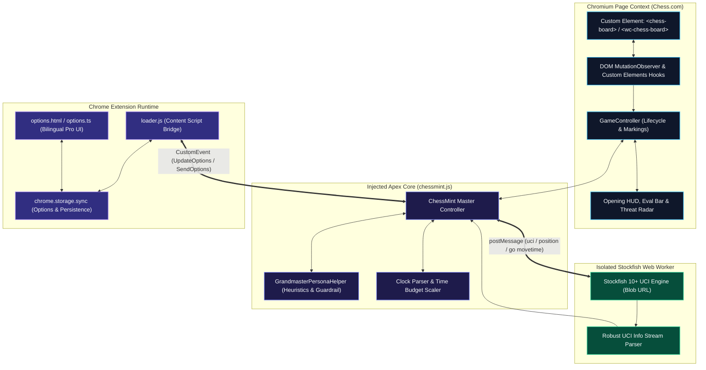

<div align="center">

<p align="center">
  
</p>

# APEX CHESS

### Tactical Engine Assistant & Real-Time Analyzer for Chess.com

[](https://github.com/Rangga11268/apex-chess/releases/tag/v2.2.0)
[](https://developer.chrome.com/docs/extensions/mv3/intro/)
[](https://stockfishchess.org/)
[](https://www.typescriptlang.org/)
[](LICENSE)
[](test/test_chessmint.js)

<p align="center">
  <b>English</b> • <a href="./README.id.md">Bahasa Indonesia</a>
</p>

<p align="center">
  <a href="#overview">Overview</a> •
  <a href="#key-features">Key Features</a> •
  <a href="#grandmaster-personas">Grandmaster Personas</a> •
  <a href="#system-architecture">Architecture</a> •
  <a href="#quick-installation">Installation</a> •
  <a href="#configuration">Configuration</a> •
  <a href="#fair-play-notice">Fair Play</a>
</p>

<p align="center">
  
</p>

</div>

---

## Overview

**Apex Chess** is an advanced Chromium browser extension delivering local Stockfish chess engine evaluations, multi-tier move recommendations, grandmaster playing style emulations, and real-time opening recognition directly on [Chess.com](https://www.chess.com).

Engineered with privacy and performance in mind, Apex Chess executes Stockfish entirely inside a client-side Web Worker. **No game data, FEN strings, or credentials ever leave your machine.**

---

## Key Features

| Category | Feature | Description |
| :--- | :--- | :--- |
| **Engine Core** | **Local Stockfish Worker** | Runs an offline Stockfish UCI engine in a dedicated Web Worker via Blob URL with zero external server requests. |
| **Tactics** | **Grandmaster Personas** | Emulate historical world champions (Carlsen, Tal, Kasparov, Nakamura, Karpov) with a strict $\le 65\text{ cp}$ anti-blunder guardrail. |
| **Speed** | **Adaptive Blitz & Bullet** | Reads match clocks dynamically to scale thinking budgets from 1200ms (Rapid) down to 120ms (Bullet) and 60ms (Panic <10s). |
| **Vision** | **Tactical Move Spectrum** | Classifies candidate moves with color-coded native arrows and badges: Brilliant (`#1baca6`), Best (`#9eba5a`), Excellent, Inaccuracy, and Blunder. |
| **HUD** | **Opening Book & ECO HUD** | Instantly identifies official chess openings (e.g. `[C60] Ruy Lopez`, `[B20] Sicilian Defense`) directly above the board. |
| **Advantage** | **Dynamic Eval Bar** | Smooth numerical centipawn advantage and forced mate counter synchronized with board orientation. |
| **Defense** | **Opponent Threat Radar** | Highlights opponent tactical target squares in red (`#ef4444`) while waiting for their turn. |
| **Stealth** | **Boss Key (`H`)** | Instant 1-millisecond toggle to hide or restore all markings, badges, HUD, and evaluation bars. |
| **Calculation** | **Deep Search (`Spacebar`)** | Trigger an on-demand boost to Depth 22 (4,000ms budget) for complex tactical positions. |
| **Feedback** | **Self-Healing Toast** | Resilient dual-payload notification system with DOM self-repair and HUD fallback for Chess.com Vue 3 compatibility. |
| **Accessibility**| **Anti-Slop Pro UI** | Clean, distraction-free interface free of emoji slop, WCAG 2.1 AA compliant, with live bilingual switching (EN/ID). |

---

## Grandmaster Personas

Rather than behaving like a sterile, mechanical calculator, Apex Chess introduces humanized tactical emulation based on the distinctive philosophies of chess legends:

```
┌─────────────────┬──────────────────────────────────┬───────────────────────────────────────────┐
│ Persona         │ Style Philosophy                 │ Strategic Heuristics                      │
├─────────────────┼──────────────────────────────────┼───────────────────────────────────────────┤
│ Magnus Carlsen  │ Endgame Squeeze & Low-Risk Squeeze│ Prioritizes endgame transitions, queen     │
│                 │                                  │ trades, deep central control & prophylaxis│
│ Mikhail Tal     │ Romantic Attacks & Sacrifices    │ Aggressive king-side assaults, piece lines │
│                 │                                  │ into enemy territory, sacrificial chaos   │
│ Garry Kasparov  │ Central Dominance & Dynamic Drive│ Relentless pawn center control (d4/e4),   │
│                 │                                  │ piece mobility & dynamic attacking momentum│
│ Hikaru Nakamura │ Speed Tactics & Swindles         │ Sharp tactical traps, fianchetto diagonals,│
│                 │                                  │ tricky knight outposts & flank play       │
│ Anatoly Karpov  │ Prophylactic Strangulation       │ Restricts opponent counterplay, solid     │
│                 │                                  │ pawn chains, suffocating quiet maneuvers  │
│ Stockfish Pure  │ Mathematical Calculation         │ Pure unbiased minimax evaluation (Default)│
└─────────────────┴──────────────────────────────────┴───────────────────────────────────────────┘
```

> [!IMPORTANT]
> **Anti-Blunder Guardrail ($\le 65\text{ cp}$)**: Every persona recommendation is strictly bounded within a $65\text{ centipawn}$ margin of Stockfish's optimal engine move. If a persona preference exceeds this safety delta or walks into a forced mate, Apex Chess automatically rejects it in favor of the best engine continuation.

---

## Adaptive Blitz & Bullet Time Management

Apex Chess monitors the active match clock to ensure you never lose on time:

```
Match Clock Remaining
 ├── > 340s (Classical / Rapid / Bot) ──> 1200ms compute | Depth User | 800-2200ms auto-move delay
 ├── 71s - 340s (5-Min Blitz)         ──>  650ms compute | Depth <= 11 | 400-850ms auto-move delay
 ├── 11s - 70s  (3-Min / 1-Min Bullet) ─>  120ms compute | Depth <= 8  | 80-220ms auto-move delay
 └── <= 10s     (Critical Panic Mode) ──>   60ms compute | Depth <= 6  | 30-80ms auto-move delay (Forces #1 Move)
```

---

## System Architecture



---

## Quick Installation

### Method A: Download Pre-built Release (Recommended)
1. Download **[`apex-chess-v2.2.0.zip`](https://github.com/Rangga11268/apex-chess/releases/download/v2.2.0/apex-chess-v2.2.0.zip)** from the latest release.
2. Extract the zip file to a folder on your computer.
3. Open your Chromium browser and go to the extensions management page:
   - **Chrome**: `chrome://extensions/`
   - **Brave**: `brave://extensions/`
   - **Edge**: `edge://extensions/`
4. Toggle **Developer mode** in the top-right corner.
5. Click **Load unpacked** and select the extracted folder.
6. Open [Chess.com](https://www.chess.com) and start an analysis board or practice match!

### Method B: Build from Source
```bash
# 1. Clone repository
git clone https://github.com/Rangga11268/apex-chess.git
cd apex-chess

# 2. Install dependencies
npm install

# 3. Compile extension bundle
npm run build

# 4. Run automated test suite
npm test
```
Load the `dist/` directory via **Load unpacked** in your browser.

---

## Configuration

Click the Apex Chess icon in your browser toolbar to customize settings:

| Option | Default | Options / Range | Purpose |
| :--- | :---: | :---: | :--- |
| **Engine Depth** | `12` | `1 – 25` | Maximum search depth for tactical calculation |
| **CPU Threads** | `2` | `1 – 8` | Web Worker thread concurrency limit |
| **Grandmaster Style** | `Stockfish Pure` | `Engine`, `Magnus`, `Tal`, `Kasparov`, `Nakamura`, `Karpov` | Humanized playing style with $\le 65\text{ cp}$ safety guardrail |
| **Move Analysis Style**| `Full Spectrum` | `Full Spectrum`, `Stealth (Safe)`, `Top Move Only` | Visual classification mode for hints |
| **Show Move Hints** | `Enabled` | Toggle | Show arrows only on your turn |
| **Move Quality Analysis**| `Enabled`| Toggle | Annotate destination squares with quality badges |
| **Evaluation Bar** | `Enabled` | Toggle | Display live numerical and visual centipawn advantage |
| **Depth Progress Bar** | `Enabled` | Toggle | Real-time Stockfish calculation depth indicator |
| **Opening HUD (ECO)** | `Enabled` | Toggle | Banner showing opening names and ECO codes above board |
| **Opponent Threat Radar**| `Enabled`| Toggle | Red highlight showing opponent's primary attacking threat |
| **Adaptive Timing** | `Enabled` | Toggle | Scale engine speed and auto-move delay to active match clock |
| **Boss Key (`H`)** | `Enabled` | Toggle | Instant 1ms toggle for stealth mode |
| **Deep Search (`Space`)**| `Enabled` | Toggle | Press Spacebar to calculate Depth 22 for 4000ms |
| **Auto Move** | `Disabled` | Toggle | Humanized automatic moves with anti-cheat jitter |
| **Language** | `ID / EN` | `ID`, `EN` | Instant live interface language switcher |

---

## Keyboard Shortcuts

| Shortcut | Action | Description |
| :---: | :--- | :--- |
| <kbd>H</kbd> | **Boss Key (Stealth Mode)** | Instantly hides or unhides all arrows, badges, eval bar, and HUD. |
| <kbd>Space</kbd> | **Deep Search Boost** | Forces an on-demand deep calculation at Depth 22 with status toast. |

---

## Project Structure

```
apex-chess/
├── dist/                      # Production extension bundle (Load Unpacked)
│   ├── css/                   # Stylesheets (depthbar, evalbar, options)
│   ├── html/                  # Extension popup UI (options.html)
│   ├── img/                   # Brand assets and icons
│   ├── js/                    # Compiled bundles (chessmint, loader, options, stockfish)
│   ├── eco.json               # Local opening encyclopedia (ECO A00–E99)
│   └── manifest.json          # Manifest V3 configuration
├── docs/                      # Research and architecture documentation
│   └── research_grandmaster_personas.md
├── img/                       # Repository banners and screenshots
├── src/                       # TypeScript source code
│   ├── chessmint.ts           # Core engine, HUD, markings, personas & lifecycle
│   ├── interfaces.ts          # Type contracts, personas & options definitions
│   ├── loader.ts              # Content script bridge & storage dispatcher
│   └── options.ts             # Popup settings controller & bilingual engine
├── test/                      # Automated test suite
│   ├── test_chessmint.js      # Build artifact & engine integration checks
│   └── test_diagnostics.js    # Diagnostic regression tests
├── CHANGELOG.md               # Version history
├── package.json               # Node.js project manifest & scripts
├── tsconfig.json              # TypeScript compilation rules
├── webpack.config.js          # Webpack bundling configuration
├── README.md                  # English documentation (Canonical)
└── README.id.md               # Dokumentasi Bahasa Indonesia
```

---

## Fair Play Notice

Apex Chess is built for study, opening preparation, post-game analysis, and offline bot training. Using automated engine assistance in rated multiplayer matches against human opponents violates the [Chess.com Fair Play Policy](https://support.chess.com/article/648-what-are-the-fair-play-policies). Please use this tool responsibly and respect the chess community.

---

## License

This project is licensed under the [MIT License](LICENSE).
Part of this project is based on the original ChessMint open-source project.
All chess opening classifications and Stockfish engine components are used under their respective open-source licenses.
