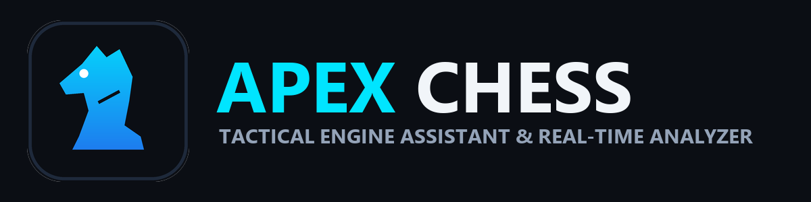

# Apex Chess: Real-Time Stockfish Analysis Extension for Chess.com

[](https://opensource.org/licenses/MIT)
[](https://stockfishchess.org/)
[](https://developer.chrome.com/docs/extensions/mv3/intro/)

Apex Chess is a Chromium browser extension providing local Stockfish chess engine evaluations, multi-tier move recommendations, and opening recognition on [Chess.com](https://www.chess.com).

Powered by an offline Web Worker build of Stockfish, Apex Chess evaluates positions locally on your machine with zero external network requests or third-party servers.

<p align="center">
  
</p>

## Overview

- **Engine Core**: Stockfish 10+ UCI engine running locally inside a Web Worker.
- **Move Classification**: Multi-level evaluation displaying Brilliant, Best, Good, Inaccuracy, Mistake, and Blunder moves.
- **Visual Indicators**: Native board arrows and destination badges matching Chess.com design standards.
- **Privacy First**: Fully offline execution. No user data, game data, or tokens leave your local device.
- **Bilingual Support**: Instant live toggle between English (EN) and Bahasa Indonesia (ID).

## Features

### Real-Time Engine Evaluation
Positions are sent to the offline Stockfish engine upon board mutation. Calculation operates with configurable depth ceilings (depth 10 to 25) and hardware concurrency limits to keep CPU usage controlled.

### Turn-Locked Calculation
Calculations and hint arrows only activate when it is your turn to move. When waiting for the opponent, board observers stay dormant to save system resources.

### Move Quality Spectrum & Board Markings
Apex Chess parses MultiPV engine lines to categorize available moves:
- **Brilliant Move** (`#1BACA6`): High-value tactical sacrifices and game-changing lines, annotated with a star badge.
- **Best Move** (`#9EBA5A`): Optimal continuation evaluated by the engine.
- **Good / Excellent** (`#5C8BB0`): Solid positional moves maintaining equality or advantage.
- **Inaccuracy & Mistake** (`#E6912C`): Suboptimal candidate lines.
- **Blunder** (`#FA412D`): Tactically flawed moves to avoid.

### Stealth Mode (Humanized Play)
Includes optional safeguards for study and non-destructive practice:
- **Dynamic Calculation Delay**: Adds randomized thinking time (800ms to 2200ms) before rendering moves.
- **Candidate Move Jitter**: Randomizes selection between rank-1 and rank-2 engine lines (~25% distribution) to emulate natural human accuracy curves rather than robotic 100% CAPS precision.

### Adaptive Blitz & Bullet Speed-Up
Automatically reads match clocks and dials engine computation time and auto-move delays to the active pace:
- **Bullet (<= 70s / 1m & Hyperbullet)**: Engine calculation capped at 120ms with 80ms to 220ms play delay.
- **3-Minute Blitz (<= 200s)**: Engine calculation tuned to 350ms with 200ms to 450ms play delay.
- **5-Minute Blitz (<= 340s)**: Engine calculation tuned to 650ms with 400ms to 850ms play delay.
- **Time Trouble (< 10s remaining)**: Overdrive mode with 60ms engine calculation and 30ms to 80ms moves, locking to rank-1 moves to prevent flag loss.
- **Rapid, Classical & Bots (> 340s or untimed)**: Preserves deep analysis (1200ms compute, full user-specified search depth, and natural 800ms-2200ms cadence).

### Evaluation Bar & Opening Book
- **Advantage Bar**: Live centipawn and forced mate counter adjusting to your active side (White or Black).
- **Opening HUD & ECO Book**: Real-time display of opening names and ECO classifications (e.g. `[C60] Ruy Lopez`, `[B20] Sicilian Defense`) directly above the board layout without external requests.

### Tactical Power Tools
- **Boss Key (`H`)**: Instantly toggle all assistance overlays (arrows, eval bar, badges, HUD) on and off in 1 millisecond.
- **Opponent Threat Radar**: Live tactical danger detection highlighting opponent counter-threat targets in crimson (`#ef4444`) while waiting for their turn.
- **On-Demand Deep Calculation (`Spacebar`)**: Instant deep search override (depth 22, 4000ms budget) for complex positions with status badge.

## Installation

### Prerequisites
- Node.js 18+ and npm
- A Chromium-based browser (Google Chrome, Brave, Microsoft Edge, Opera, or Vivaldi)

### 1. Clone the Repository
```bash
git clone https://github.com/Rangga11268/apex-chess.git
cd apex-chess
```

### 2. Install Dependencies and Build
```bash
npm install
npm run build
```

Run test verification to confirm all artifacts are ready:
```bash
npm test
```

### 3. Load the Extension into Your Browser
1. Open your browser and visit:
   - Chrome: `chrome://extensions/`
   - Brave: `brave://extensions/`
   - Edge: `edge://extensions/`
2. Turn on **Developer mode** (toggle switch in the top-right corner).
3. Click **Load unpacked** (or *Muat yang belum dibongkar*).
4. Select the `dist/` folder inside the cloned `apex-chess` directory.
5. Navigate to [Chess.com](https://www.chess.com) and start an analysis board or practice match.

## Configuration

Click the Apex Chess icon in your browser toolbar to configure engine behavior:

| Setting | Default | Description |
| :--- | :---: | :--- |
| **Engine Depth** | `12` | Calculation depth limit (1 to 25) |
| **CPU Threads** | `2` | Web Worker thread concurrency |
| **Hint Mode** | `Full Spectrum` | Choose between Full Spectrum, Stealth (Humanized), or Classic Best Move |
| **Show Move Hints** | `Enabled` | Renders color-coded arrows on your turn |
| **Move Quality Analysis** | `Enabled` | Shows destination square badges (Brilliant, Best, Inaccuracy, Blunder) |
| **Evaluation Advantage Bar** | `Enabled` | Displays numeric score and advantage bar beside the board |
| **Depth Progress Bar** | `Enabled` | Shows active calculation depth progress |
| **Language** | `EN / ID` | Switch between English and Bahasa Indonesia |

## Technical Architecture

- **Extension Framework**: Chrome Extension Manifest V3 (MV3)
- **Engine Worker**: Offline Stockfish ASM.js / WebAssembly instantiated via Blob URL
- **Languages**: TypeScript, HTML5, CSS3
- **Bundler**: Webpack 5
- **DOM Integration**: Direct observer hooks for both `<wc-chess-board>` and `<chess-board>` custom elements

## Development & Testing

Run unit checks on extension bundles, manifest schema, and engine artifacts:
```bash
npm test
```

Rebuild source changes during development:
```bash
npm run build
```

## Fair Play Notice

Apex Chess is built for study, opening preparation, post-game analysis, and offline bot training. Using automated engine assistance in rated multiplayer matches against human opponents violates the [Chess.com Fair Play Policy](https://support.chess.com/article/648-what-are-the-fair-play-policies). Please use this tool responsibly and respect the chess community.

## License

This project is licensed under the [MIT License](LICENSE).
